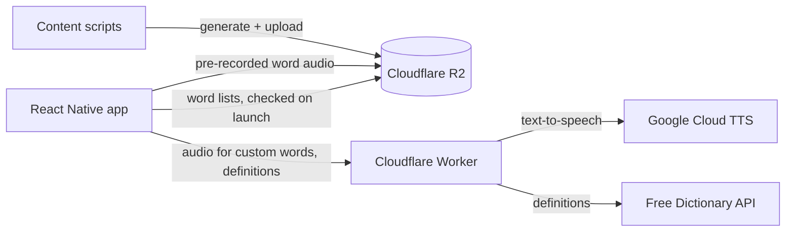

# SpellSmart

A spelling practice app for students preparing for the [UIL A+ Spelling](https://www.uiltexas.org/aplus/events/spelling) contest in Texas, and for anyone who wants to drill their own word lists.

[**Download on the App Store**](https://apps.apple.com/us/app/spellsmart/id6480376688)

<!-- Screenshots: add 3–4 phone screenshots here (Practice, Solo mode, a word list, results). -->

## Features

- **Official UIL lists** for grades 3–4, 5–6 and 7–8, updated for 2026–27. Words with two accepted spellings (`vapor, vapour`) accept either one.
- **Solo mode**: the app says a word aloud and you type it. After a wrong answer, it spells the word out loud letter by letter and you try again.
- **Buddy mode**: a friend holds the phone, hears the word and marks your spoken spelling right or wrong, like a real spelling bee.
- **Custom lists**: type words, paste a block of text, or take a photo of a printed list. Words are read from the photo on the device.
- **Bookmarks, missed words and definitions**: review the words you got wrong, and look up any word's meaning.
- **Streaks and daily reminders** to keep practicing.

## How it works



- **Word lists update without an app release.** The app fetches lists from R2 using an ETag, so unchanged lists aren't downloaded again. It falls back to a cached copy, then to lists bundled in the app, so it works offline.
- **Audio falls back in three steps.** Every list word has a pre-recorded clip on R2, generated by `scripts/generate-audio.mjs`. Custom words go through the Worker, which calls Google Cloud Text-to-Speech and caches the result at the edge. If both fail, the device's built-in speech takes over.
- **No API keys in the app.** Google Cloud credentials live only in the Worker as secrets. Earlier versions called AWS directly from the app with an embedded key; moving that behind the Worker drove the April 2026 overhaul.
- **Code updates ship over the air** with EAS Update. App Store builds are only needed for native changes.

## Tech stack

React Native 0.81 · Expo SDK 54 · EAS Build and Update · Cloudflare Workers and R2 · Google Cloud Text-to-Speech · on-device ML Kit text recognition

## Project structure

```
src/
  screens/      one file per screen (Solo, Buddy, Lists, Settings, ...)
  components/   shared UI
  utils/        word lists, speech, streaks, storage, migrations
  theme/        colors, spacing, type scale
data/lists/     UIL word lists (JSON), published to R2
worker/         Cloudflare Worker: text-to-speech and definitions
scripts/        audio generation, R2 publishing, tests
```

## Running locally

```bash
npm install
npx expo start
```

The app uses native modules, so it needs a [development build](https://docs.expo.dev/develop/development-builds/introduction/) rather than Expo Go. Headings use Feather Bold, a commercial font that isn't included in this repo. Without it, headings fall back to Nunito.

Tests (answer checking, custom lists, list downloads, streaks, saved-data migration and the word-list data), linting and formatting:

```bash
npm test
npm run lint
npm run format
```

CI runs all three plus a bundle build on every push.

To regenerate audio and publish lists, copy `.env.example` to `.env`, fill it in, then run `npm run generate-audio` and `npm run publish-content`. Worker setup is in [worker/README.md](worker/README.md).

## License

Copyright © Aariv Modi. All rights reserved. The source is public for reading; it may not be copied, modified or redistributed without permission.
